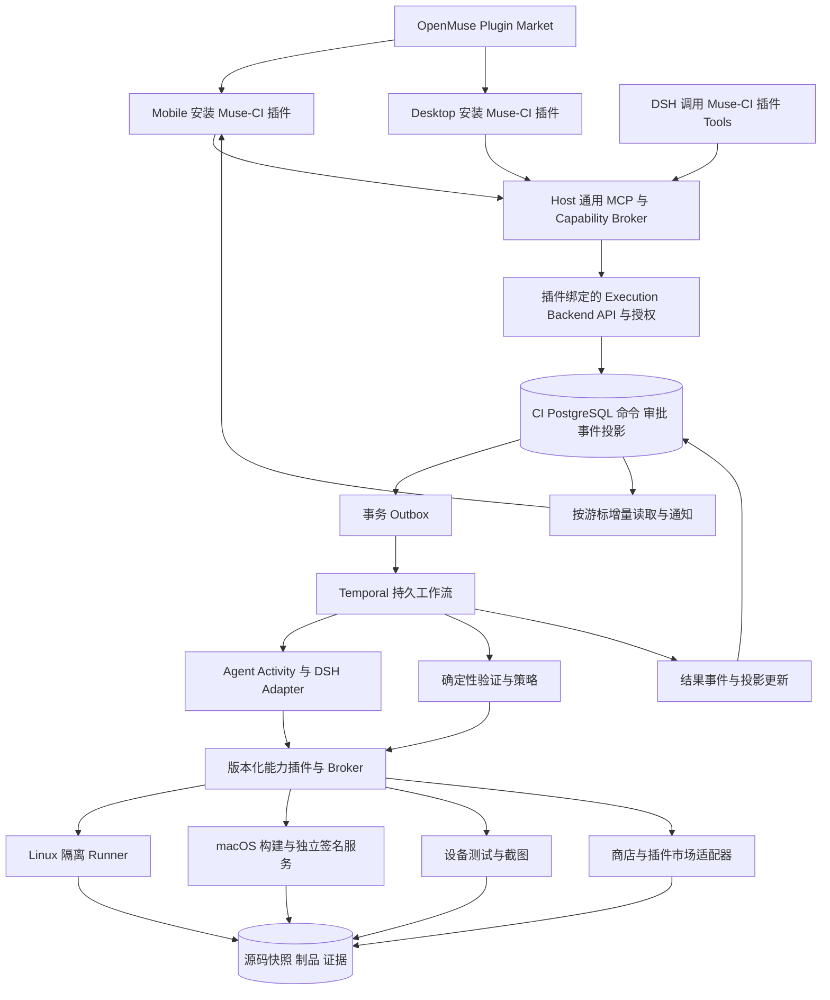

# Muse CI 最终架构方案

日期：2026 年 11 月 18 日。状态：架构定案，开发闭环已实施；生产部署、真实 AI 及 Mobile 原生安装仍待验收。本文以当前工程为依据，为产品、研发、测试、插件交付及 App 上架建立统一的 AI 原生交付系统。

**最终采用：可独立安装的 OpenMuse Muse-CI 产品插件 + 云端或自托管 Execution Backend + Temporal 持久工作流 + DSH Agent 执行适配器 + 隔离 Runner。Muse-CI 插件本身在 Desktop 和 Mobile 的插件市场安装、启用、升级与卸载；两端使用同一插件身份、项目和 Run。** AI 将需求转成可验收的工作计划，调用插件执行并根据证据修复；确定性工作流持有阶段状态、预算、授权、取消和恢复。所有平台共享同一个 Run，手机退出不影响执行。

## 1 产品定位和决策

Muse-CI 是 OpenMuse 插件生态中的一个完整产品插件，候选稳定 ID 为 `io.openmuse.ci`；不是编译进 Host 的 CI 页面，也不是只有服务端 CI 再附带一个手机遥控插件。插件拥有交付中心 UI、命令与 Agent Tools、需求及计划模型、工作流模板、验收规则和 Provider 依赖声明。执行后端负责持续运行、凭据及平台执行条件，不改变产品插件的安装与生命周期边界。

Muse-CI 面向从想法到发布的完整交付过程。用户可以从 Mobile 发起“解决这次 Apple 拒审，验证完成后准备重新提审”，系统读取拒审证据、产品范围和工程基线，生成变更与验收计划，执行开发、测试、构建及材料准备，最后在明确的权限范围内推进发布。

AI 原生的具体含义是：需求、约束、验收标准、可用能力、源码、工具结果、审查意见和产品反馈都是可引用的运行输入。每个智能步骤输出结构化提案及证据，而非依靠聊天上下文记住状态。AI 能修改计划、选择检查项、定位失败、生成补丁并复验；工作流持续验证其行为是否满足任务、授权和发布约束。

| 决策 | 确定方案 | 对当前工程的影响 |
| --- | --- | --- |
| 产品交付单元 | 可安装的 `io.openmuse.ci`，Desktop 与 Mobile 同一产品身份 | 从市场后装，Host 不内置 CI 业务插件 |
| 工作流内核 | Temporal，TypeScript Workflow/Activity | 由后端装载经审核固定版本的工作流；不改写 DSH Agent Loop |
| 控制服务 | TypeScript API 与 worker，共用版本化 contracts | 复用生态 TypeScript 工具链；既有 Rust/Flutter 仍以协议接入 |
| 身份和业务数据 | 验证现有 GoTrue 身份；CI 自有 PostgreSQL 数据库与角色 | 用户身份复用，CI 不直接写 AppFlowy 业务表 |
| 执行环境 | Linux 隔离 Runner、macOS 专用构建机、按需真机池 | iOS 签名不放在手机或通用 Agent 沙箱中 |
| 制品和证据 | 独立 S3 兼容存储命名空间，按摘要寻址 | 复用部署能力，不绑定具体对象存储厂商 |
| AI 执行 | 每个任务独立 DSH 会话和 Workspace lease | fs 与 subprocess 必须指向同一执行世界 |
| 插件协议 | 标准 MCP/MCP Apps 与现有 Capability SDK，CI 领域数据契约 `openmuse.ci/1` | 插件独立贡献 UI 与工具；安装不自动获得发布或宿主机权限 |
| 跨端界面 | 可安装远端 MCP App 的固定摘要 HTML/CSS/JS UI artifact，Desktop 和 Mobile 共用响应式 UI | 首版补齐通用 Host 安装与绑定能力；无需内置 ci-control 或下载新 Dart/原生执行代码 |
| 现有 CI | GitHub Actions、现有脚本接为执行器 | 保留检查资产，由 Muse-CI 汇总证据和业务状态 |
| 上架 | 继续使用现有十二阶段定义和正式签名脚本 | 新增可靠编排和证据验证，不另造一套放行规则 |

初期不增加 Kafka、向量数据库或另一套自研持久调度器。代码检索先用固定源码快照、rg、符号索引和明确资源引用；只有实际检索评估证明需要时再引入语义索引。

## 2 工程现状和接入依据

检视基线：Muse-Client `04ba4adc`，Muse-Plugin-Ecosystem `fc5b717`。本文件原为空文件，以下方案依据实际代码和工程文档确定，不代表已确认过另一份未保存讨论。

| 现有资产 | 可直接复用的部分 | 新增工作或边界 |
| --- | --- | --- |
| [Host 架构](../../Muse-Client/docs/architecture/PLUGIN-HOST-DSH-ARCHITECTURE.zh-CN.md) | 插件生命周期、Broker、资源与权限边界 | CI 服务不进入 Host 核心，业务 UI 属于插件 |
| [DSH 契约](../../Muse-Client/contracts/dsh/0.2.0-rc.2.contract.json) | 固定版本的 shell/fs/subprocess/jobs 能力 | 每次 Run 固定适配器版本；不能把 DSH 后台任务当作可靠 CI 调度器 |
| [Workspace Sandbox 设计](../../Muse-Client/docs/dsh/DSH-WORKSPACE-EXECUTION-PLANE-FEASIBILITY.zh-CN.md) | lease、revision、物化与成对执行面设计 | 设计文档不等于生产落地；Runner 必须独立通过隔离验收 |
| [Plugin Capability SDK](../../Muse-Plugin-Ecosystem/packages/plugin-sdk/src/index.ts) | providers、bind、invoke 和 serverTools 交互形式 | 需注册 CI provider、绑定资源和权限，现有 SDK 不自动提供 CI 服务 |
| [Plugin DevKit](../../Muse-Plugin-Ecosystem/plugins/developer-kit/src/index.ts) | 工程初始化、校验、打包和待审提交能力 | 当前 pack 是受限打包，不是通用编译 Runner；平台审批继续独立 |
| [Mobile 入口](../../Muse-Client/app/openmuse_mobile/lib/main.dart) | Flutter 插件装配、云身份、市场与配对连接 | 当前 allowDownloadedPlugins=false，MCP 允许包集合为空；需先补通用市场安装、非文件型 MCP App 与远端绑定支持，不能靠内置 CI 绕过 |
| [Remote Workbench](../../Muse-Client/plugins/remote-workbench/lib/openmuse_remote_workbench.dart) | 配对 Desktop 远程 surface 和交互组件 | 它面向 Desktop，不作为云端 CI 的可靠服务端和唯一通路 |
| [上架定义](../../Muse-Client/config/release/pipeline.json) 与 [pipeline.py](../../Muse-Client/scripts/release/pipeline.py) | 阶段 DAG、回执、证据和上传前检查 | 现有回执仍是人工记录；需增加服务端事实验证和签名证据 |
| [GitHub workflow](../../Muse-Client/.github/workflows/release-pipeline.yml) | 定义、边界测试和记录校验 | 当前主要校验记录，不是完整构建、自动提审或持久工作流 |
| [拒审整改计划](../../Muse-Client/docs/release/runs/2026-11-mobile-isolation/REVIEW-RECOVERY.zh-CN.md) | 真实产品问题与 R01 至 R12 验收任务 | 作为第一条端到端试点，不能把规划状态转写为已完成 |

## 3 系统结构



责任分工：Muse-CI 产品插件拥有 UI、交付计划及流程模板；Host 只管通用安装、容器、凭据代理、能力绑定和生命周期；API 负责租户权限、资源绑定和命令接收；Temporal 负责 Run 的执行进度和恢复；PostgreSQL 保存命令、审批决策及可查询投影；Runner 执行受限作业；制品库保存大对象。DSH 只在获批的执行环境内推理和调用工具，不负责保存发布真相。

Temporal 与 PostgreSQL 的业务投影不能各自独立推进同一个 Run。API 在一个事务内写入 Command 和 Outbox；dispatcher 以 commandId 幂等投递 Workflow Update；Workflow 执行结果以 `(runId,eventSeq)` 幂等更新投影。界面先显示 command=accepted，收到执行事件后才显示 applied；掉线和投影落后不会被解释成操作成功。

## 4 领域模型和真源

| 对象 | 关键内容 | 真源 |
| --- | --- | --- |
| Project | account/org、仓库、环境、插件、默认策略、预算 | CI PostgreSQL |
| WorkItem | 需求、验收条件、缺陷、拒审问题、范围约束及引用 | CI PostgreSQL；SmartDocument 是编辑和展示入口 |
| PlanRevision | 有类型的任务 DAG、能力需求、预算、验收与依赖摘要 | 不可变计划版本 |
| SourceSet | 所有实际构建输入的仓库 commit、子模块、lock、工具链与摘要 | 源码快照与 manifest |
| Run / Step / Attempt | 执行状态、依赖、lease、超时、重试和预算消耗 | Workflow History；数据库为查询投影 |
| ChangeSet | 补丁、分支、PR、对应源码版本与审查结果 | Git 内容及 CI 关联记录 |
| Evidence | 生成者、输入摘要、命令/策略版本、输出摘要和事实类型 | 制品库不可变对象及索引 |
| Approval | 人员、角色、具体操作、输入与制品摘要、有效期 | CI PostgreSQL 事务记录；Workflow 验证后生效 |
| Release | 版本、渠道、build、阶段和候选制品关联 | CI 版本化 release aggregate；Git JSON 为带 revision 的导入导出 |

导入既有 `release.json`、`tasks.json`、`stages/*.json` 后，建立一次明确的接管 revision。执行期间只有服务端推进 Release；Git 导出为快照和审查材料。外部文件改动必须经 expectedRevision 导入，冲突拒绝，禁止两边最后写入覆盖。

所有可发布输入必须形成 SourceSet，至少覆盖 Muse-Client、实际用到的 Muse-Plugin-Ecosystem、服务及站点 revision，以及引用到的外部引擎。相邻目录、未提交插件或本地原生库不能隐式成为发布输入。开发 Run 可以使用记录过的 patch，正式 Run 必须采用审查后的冻结输入；遵守现有 sourceFrozen 关口。

## 5 AI 工作机制

一条产品需求进入 WorkItem 后，流程为：`理解范围 → 形成计划 → 受限执行 → 采集证据 → 独立验证 → 修复或等待决定 → 交付`。

- **Planner**：读取明确授权的需求、仓库和失败证据，输出 PlanRevision。每个 Step 必须声明输入、前置、能力、可写范围、网络、预算、输出及验收器。
- **Implementer**：在隔离 checkout 中改代码，交付补丁及测试结果；按任务拥有文件或分支 lease，避免并行修改互相覆盖。
- **Verifier**：运行既有脚本、测试和真实制品验证；AI 审查可以提出问题，但不能替代验证器的退出码、制品摘要或人员结论。
- **Release Assistant**：整理渠道差异、截图、说明和反馈修复建议；名称权利、隐私法律结论及实际商店状态仍由相应主体或权威接口证明。

这些是角色与权限配置，首版不要求多 Agent 并发。先用同一 DSH 引擎顺序执行不同角色；只有独立任务具备可隔离输入和明确收益时才并发。写代码的 Agent 不能签发自己的发布通过证据。

LLM、网络、Git、构建和 shell 都在 Activity 内运行，不能进入需要确定性重放的 Workflow 代码。模型的结构化决策或其不可变对象引用保存为 Activity 输出，工作流恢复不重新随机规划。原始提示词、完整源码、大日志和二进制不进入 Workflow History，只存受控对象引用及摘要，并配置服务端加密和访问权限。模型或计划升级产生新 PlanRevision，显式记录旧任务如何取消、复用或重跑。

每个任务同时限制 token、费用、墙钟、并发、磁盘和重试次数。首版默认最多 3 次修复尝试；达到任一预算即等待用户决定，不通过重复尝试消耗无限资源。失败解释必须引用真实日志和变更；修复后只重跑受影响依赖及必要验收，禁止删测试或降低关口来获取通过。

仓库文件、插件描述、网页和拒审信都是输入数据。它们不能扩大能力或覆盖 ProjectPolicy；Agent 的结构化工具请求仍由 Broker 验证，防止提示注入转成密钥访问或发布命令。

## 6 执行环境和失败语义

| Runner | 作业 | 隔离和限制 |
| --- | --- | --- |
| Linux | Dart/Flutter 分析与适用测试、Rust/Node、Android、服务和 Web | 每 Attempt 独立容器或 VM，固定镜像摘要、非 root、限额与网络策略 |
| macOS | Xcode 构建、iOS/macOS 归档与验证 | 专用可重置 VM/受管机器，固定 Xcode、SDK、Rust、Flutter；不能宣称普通进程具备容器级隔离 |
| Signing | 对已验证候选输入执行正式构建签名或签名 | 独立身份和队列；拒绝任意 Agent shell、构建脚本持有长期密钥 |
| Device | 真机安装、权限、生命周期、截图和体验验收 | 设备独占 lease、清理账号及数据；模拟器报告明确标记 |
| Existing CI | GitHub Actions 或既有受控主机 | 固定 revision、workflow 与外部 runId；核验 webhook 和制品来源 |

DSH 的 fs、shell、subprocess、PTY 和 jobs 必须由同一个 lease 的适配器提供。不能在云端读文件、在 Desktop 改另一份目录。构建缓存按工具链、源码输入和平台区分；PR 与发布签名缓存隔离，命中缓存也要验证摘要及来源。

长运行按任务或审核 cycle 分段，使用 Continue-As-New 控制 History 增长。面向 Mobile 的 ciRunId 保持稳定，与 Temporal 的执行 RunId 分开；事件游标在分段后仍单调递增。

平台允许的重试是至少一次执行语义，不承诺外部世界 exactly-once。每个动作有 operationId；Runner lease 带 fencingToken，失效 Attempt 不得提交结果或领取新密钥。Webhook 用 provider+eventId 去重，迟到结果仅记审计，不推进新版本。

外部上传、提审、发布超时后进入 `reconciling`，先按渠道与操作标识查询实际状态。若渠道不能可靠查询，进入 `needs_decision`，不能直接重发。构建号分配按 app+channel 加锁并查询平台，不能只靠本地自增。

暂停阻止新 Step 调度，不假定已发生的上传能撤回。取消要等待 Runner 确认终止、销毁 lease 并清理进程；UI 在此之前显示 cancel_requested。设备离线、Runner 失联或凭据过期均保留任务与证据，按策略恢复，不从头重跑整条发布链。

## 7 产品插件的安装交付和能力合同

### 7.1 插件发行物

`io.openmuse.ci` 作为市场中的一个可安装产品，用户选择安装到 Desktop 或 Mobile。插件发行由三个相互关联、分别校验的部分构成：

| 部分 | 内容 | 安装和执行位置 |
| --- | --- | --- |
| Portable App UI artifact | 响应式 MCP App UI、静态资源、公开合同和依赖锁 | 两端通过插件市场安装，在 Host 受限 WebView 中加载 |
| CI workflow bundle | 需求到交付的模板、Agent 角色和策略声明、Provider 依赖及验证器引用 | 由绑定的后端审核、安装并固定版本；UI 安装不能让任意代码进入 Temporal Worker |
| Backend/Runner artifacts | API、Temporal worker、运行适配器及平台 Runner 的签名发行物 | 云端或管理员部署的自托管环境；不要求 Mobile 执行这些程序 |

一份 release lock 关联 pluginVersion、UI digest、contractVersion、workflowBundle digest 和兼容后端版本。跨端 Portable App 共用插件身份、版本和 UI artifact 摘要，不要求各端使用同一个标准 MCPB 文件；需要平台伴随程序时单独声明精确 target artifact，不把 Desktop 可执行程序作为 Mobile fallback。代码仓库 Muse-CI 可以独立，市场目录在 Muse-Plugin-Ecosystem 登记版本、来源和发行引用，不复制第二份业务源码。

采用生态现有 MCP Registry server.json 和 MCP Apps 通信，新增 OpenMuse 可安装远端 App 的发行锁和 UI artifact 关联 profile。当前 MCPB 标准的 manifest 要求 server 配置；不把纯 UI-only 包伪称为标准 MCPB。既有 Node MCPB 发行路径保留兼容。CI 业务字段放在版本化合同和依赖锁中，不擅自在严格的 Manifest v2 增加顶层字段。签名、摘要、兼容性和权限校验由通用安装器完成。

### 7.2 用户安装和连接

路径为：`插件市场 → Muse-CI → 安装 → 启用 → 连接执行后端 → 选择 Project/Workspace → 授权能力 → 开始交付`。Desktop 和 Mobile 各自有安装记录，同一账号连接同一项目后查看并控制同一个 Run；不用 Desktop 保持在线来使用云端 CI。

首次安装不会自动部署服务器、打开本地 shell 或获得签名密钥。用户可绑定官方托管或已部署的自托管 Execution Backend。后端尚未就绪时显示安装成功、待连接，不能伪装可执行。Desktop 的本机 Runner 是另行注册的执行能力；Mobile 可选择它，但不下载其可执行文件。

绑定通过 Host 的可信后端目录和能力授权流程完成。对自定义后端先验证实例身份、兼容版本及信任设置，再取得面向该实例的短效授权；不得向插件填写的任意 URL 转发 GoTrue 登录 token。凭据由 Host/Broker 持有，WebView 只拿绑定句柄并通过 serverTools 调用。

### 7.3 安装升级和卸载语义

- 安装并启用后注册插件卡片、命令和可授权 Agent Tools；停用时释放 UI、订阅和本设备绑定权限。
- UI 升级重新校验签名、摘要与合同兼容，支持回退。新 Provider 或工作流版本只影响新 Run；已有 Run 继续固定旧依赖与已部署的兼容 worker。
- 单设备卸载移除本机 UI、缓存及安装授权，不删除共享项目或自动取消云端 Run；其他已授权设备仍可访问。取消运行、解绑项目、关闭后端与删除数据分别作为明确的项目操作。
- 后端保留与已授权运行有关的执行记录；客户端登录撤回、项目角色撤销和运行授权撤销按各自范围生效，不能混同为简单关闭 WebView。

### 7.4 插件提供的 CI 能力

CI 的业务能力以 Provider 插件贡献，不以 Host 中的插件名判断分支实现。定义新领域契约 `openmuse.ci/1`；这是待实现合同，不是现有 Manifest 已支持的字段。

Provider descriptor 包含：`id/version/artifactDigest/contractVersion`、operations 的 JSON Schema、输入输出 mediaType、所需权限、运行平台、网络范围、资源预算、验证器、幂等及取消语义。安装时校验来源、签名与兼容性，执行时再按 ProjectPolicy admission。Provider 更新固定到新版本，旧 Run 保持原摘要。

能力分为 product、scm、agent、build、test、compliance、artifact、distribution 八类。第一批 Provider 对应现有 Git 操作、DSH、Flutter/Rust/Node 检查、Mobile closure、现有构建脚本与插件 DevKit。AI 可以组合已有 operation，不能在计划中临时声明自己拥有新能力。

| 面向用户和 Agent 的操作 | 语义 |
| --- | --- |
| `ci.projects.list` / `ci.runs.list` / `ci.runs.get` | 按授权范围读取项目与运行快照 |
| `ci.plans.propose` / `ci.plans.revise` | 生成或调整结构化计划，不直接发布 |
| `ci.runs.start` | 固定 PlanRevision 和 SourceSet 后启动 |
| `ci.runs.pause` / `ci.runs.resume` / `ci.runs.cancel` | 带 expectedRevision 的持久命令 |
| `ci.steps.retry` | 从明确 Step 新建 Attempt，重新评估依赖与预算 |
| `ci.evidence.get` | 读取获授权证据或短效下载引用 |
| `ci.approvals.request` | 返回具体操作及摘要，不能冒充人员同意 |
| `ci.approvals.decide` | 仅受信用户交互入口提交决策，服务端校验身份、角色与决策绑定 |

MCP tool 使用适配后的合法工具名，例如 `ci_runs_get`，输入输出复用同一 Schema；`structuredContent` 携带机器可校验结果。首版由插件自身的受信 MCP 后端实现这套工具合同，Project 选择与 ACL 属于插件后端。现有 OpenMuse Capability SDK 的 providers/bind/invoke 基于文件 bytes，不能直接用于 Project 绑定；前端跨插件非文件服务绑定作为后续通用 profile 演进，不作为 CI 首版前置。

Desktop 和 Mobile 共用插件的 MCP App UI 与 TypeScript CI contract client，通过 Host 通用 serverTools bridge 访问同一受信 MCP 后端会话。CI 项目页、计划页、决策页和交付页全部由插件包提供，不新增 Flutter CI 业务包或专用 ci-control 插件。Host 仅需要通用 MCP App 生命周期和 bridge；新的 CI 业务版本通过插件升级交付，新原生 API 或协议主版本仍需 Host 更新。

## 8 Mobile 控制体验与恢复

用户安装 Muse-CI 后，从“应用 → Muse-CI 交付中心”或插件贡献的 Run 卡片进入同一运行。首版由已安装并验证摘要的响应式 MCP App 提供页面，Desktop 与 Mobile 共用，包含五个核心视图：

1. **项目**：仓库与产品目标、当前发布、阻塞项、可用执行机。
2. **计划**：自然语言目标转成任务与验收，显示改动范围、预计资源与授权范围。
3. **运行**：阶段进度、当前操作、结构化日志、增量证据、费用及剩余预算。
4. **决策**：展示实际 diff、失败原因、制品摘要和渠道，用户可同意、拒绝或调整。
5. **交付**：包、截图、说明、测试与来源记录，以及实际商店状态。

每个执行失败卡片说明“失败在何处、影响什么、建议下一步及其代价”，提供重试单步、交给 AI 修复、改计划、取消。批准按钮绑定具体内容摘要；不使用脱离上下文的“允许所有操作”。长日志默认提供摘要与原始证据入口，不能只展示 AI 生成的结论。

Mobile 的 Host 经可信实例绑定建立 CI 会话，MCP App 通过通用 Broker 调用 CI API；服务端验证 token issuer、audience、有效期、项目成员关系和数据区域，不信任客户端提交的 userId。Desktop 断开不影响云 Runner；选择本机 Runner 时明确显示依赖设备及离线等待。

事件以 `runId + eventSeq` 分页增量读取，首版由插件通过普通 MCP tool 有界轮询读取，不要求新增 Host SSE/流式订阅。后续可在通用协议就绪后升级，UI 不直接越过 CSP 连接后端。App 回到前台先拉取快照与游标缺口，再订阅；订阅权限撤回后立即停止。APNs 通知是提示，不能作为结果真源；首版可先使用应用内通知，后台推送在凭据和端侧验收完成后启用。

断网时只能阅读已授权缓存和保存计划草稿。暂停、取消、审批、提审等控制离线显示“未发送”，不排队盲发；重新联网后校验最新 revision 和授权。用户未在线不影响服务器已获准的任务继续运行。

首版每个修改命令统一 envelope：

```json
{
  "contract": "openmuse.ci/1",
  "commandId": "uuid",
  "projectRef": "project:mobile",
  "runRef": "run:release-example",
  "operation": "ci.runs.pause",
  "expectedRevision": 12,
  "arguments": {"reason": "调整发布范围"}
}
```

actor、租户、权限来自服务端认证会话。`commandId` 重复返回同一结果；revision 不匹配返回冲突及最新引用；API 不接收任意 shell 字符串作为 Mobile 控制协议。

## 9 产品研发和上架流程贯通

工作项支持 `feature`、`bugfix`、`plugin-release`、`app-release`、`review-remediation`。共用需求、计划、变更、验证和证据机制；特定工作项在尾部接不同发布 Provider，而不是一律要求走 App 商店流程。

| 现有 App 阶段 | AI 可承担的工作 | 必须存在的事实与关口 |
| --- | --- | --- |
| 01 范围 | 整理需求、渠道、验收、计划 | 产品范围和授权版本被锁定 |
| 02 开发 | 定位问题、生成补丁、审查与回归 | ChangeSet、跨仓库 SourceSet、冻结结论 |
| 03 隐私 | 列数据流、SDK、政策差异和来源问题 | 真实行为证据与责任人结论；不能由模型声明合法 |
| 04 测试 | 选择相关检查、执行测试、解释失败 | 确定性报告与指定真机验收 |
| 05 构建 | 分派各平台受控作业 | 正式版本、签名、工具链、输入和制品摘要 |
| 06 二进制 | 检查依赖、权限、标识、内容与来源 | 最终包真实验证，metadata-only 不放行 |
| 07 物料 | 草拟截图说明、审核说明与指南 | 内容与实际产品一致、必要人工验收 |
| 08 上传 | 准备操作并调用渠道适配器 | 操作授权、上传记录与渠道安装验证 |
| 09 提审 | 整理逐条说明并执行已获准操作 | submissionId、buildId、实际平台回执 |
| 10 审核 | 分类反馈并提出修复计划 | 外部状态及消息来源；拒审转入新修复 cycle |
| 11 发布 | 按已授权地区和比例执行 | 平台通过状态及发布策略、操作回执 |
| 12 归档 | 汇总监控、复盘和完整证据 | 制品和日志保留、恢复验证及可追溯记录 |

服务导入当前 pipeline DAG，执行 adapter 继续调用 `pipeline.py check --gate ...`。初期依然遵守该工具要求证据为仓库内普通文件的约束：在专用 release checkout 中从受控对象库物化按摘要验证的证据，再运行脚本，不把 S3 URL 直接填进现有 evidence 路径。正式包先下载至验收 Runner 校验真实摘要，不能只让远端返回一个 PASS。

机器可验证阶段由受信 Verifier 生成 attestation；品牌、隐私及人工验收类回执需指定角色确认。Agent 对文件写入 passed 不具有放行权。缺少插件、证据、权限或设备时保持 pending/blocked，不得自动记作 not_applicable。

每个渠道有独立执行与状态，共享同一冻结 SourceSet；单渠道失败不把其他渠道标为失败或通过。更改 SourceSet、计划、插件版本、政策或相关制品后，按输入依赖摘要使对应测试、验收与审批失效。构建过后只更新记录与物料时，区分源码输入摘要和 release aggregate revision，避免把正确制品误当成另一份代码，也避免对无关变更重建所有平台。

首条试点采用当前 iOS 拒审整改：系统将名称/权利路线和 AI 数据授权两类问题拆开，保留人的品牌决定；推进允许范围内的改造和检查。范围未锁定时仍可做只读审查和独立技术验证，不能构建后自动声称已解决 4.1 或已重新提审。

## 10 权限隐私和证据

权限分三层：项目成员角色、计划允许范围、每次 operation 的能力 grant。产品负责人锁定范围，研发可修改代码并跑检查，测试可签发相应验收结论，发布角色可批准指定渠道动作。策略支持对低风险步骤一次授权后自动推进；默认把正式签名、上传、提审、发布、生产策略变更作为独立授权动作，可由组织配置明确范围的发布授权，而非每条 shell 都打断用户。

人员批准对象至少绑定：`project/run/planRevision/sourceSetDigest/operation/target/artifactDigest/policyVersion/expiry`。尚未有制品时，计划批准只批准工作范围，不冒充最终包批准。输入变化、角色撤销或授权过期，既有批准不能继续使用。模型请求不能自签 approval；服务端在实际执行前重新校验。

AI 数据共享与发布审批分别管理。模型调用前说明真实接收方、数据类别及用途；按项目选择允许的模型服务与区域，未知接收方阻断。源码、日志、用户文档和截图进入模型前最小化与脱敏；执行预算不替代用户数据授权。撤回停止后续发送并取消未派发作业，不宣称可以追回已发送给第三方的数据。

长期签名密钥、商店凭据和源码访问凭据由专用 Broker 管理，只向特定 Runner 发放短效、最小范围凭据或操作句柄，不下发给手机或写进模型上下文。PR Runner、Agent Runner 和签名 Runner 分权。现有构建脚本可能在构建期间使用签名环境，P3 必须完成构建/签名边界改造；不能把当前脚本原样包装就声称已经实现密钥隔离。

Evidence 至少记录：类型、生产者与版本、输入摘要、命令或验证器版本、工具链、开始/结束、exitCode、输出摘要和敏感级别。日志在 Worker 侧限量与脱敏后上传；按 tenant/region 隔离存储，短效下载 URL、可配置保留期限、删除与法定留存规则分开。审计记录外部操作意图和结果，不把完整源码与密钥复制到审计链。

采用与 SLSA provenance 相容的构建来源字段，并为实际构建输入和输出签名；仅生成 manifest 不能宣称达到某个 SLSA 等级。未知来源、必要许可证缺失、未审查引用和 Mobile 被排除依赖，都作为可定位的发布阻塞项。

## 11 状态和运维

Run 状态：`draft → planning → ready → running → succeeded / failed / canceled`，另有 `waiting_approval`、`waiting_runner`、`paused`、`reconciling`、`needs_decision`。Step 可为 running、retrying、blocked 或 terminal；不能用终端进程仍在运行来判断业务是否成功。

发布 Run 在商店等待审核时处于等待外部事件的非终态；“上传成功”是 Step 结果，不是“正式上线”。渠道观察记录 observedAt/source/status，查询失败不会改写成审核中或通过。自动修复创建新 Attempt 或修复 cycle，保留原失败和已提交版本的事实。

Temporal 首版独立部署，使用独立持久化数据库/角色；与现有 PostgreSQL 可复用基础设施，但不混用业务表或权限。CI API、dispatcher、workflow worker 和 Runner 分开部署。生产环境具备备份、恢复演练、工作流版本兼容和密钥轮换后才接正式签名。

首版监控至少包括队列等待、Runner 心跳、工作流年龄、Outbox 积压、投影延迟、凭据失败、模型费用及外部操作不确定状态。失联用 lease 和 fencing 收敛，不能仅依靠 heartbeat 在线标识判断作业所有权。

## 12 仓库和实施计划

实际产品 UI、MCP 适配与打包位于 Muse-Plugin-Ecosystem/plugins/muse-ci；执行后端位于 Muse-CI。两者以 openmuse.ci/1 版本化合同交付。下列完整生产目录是目标结构，已实施部分及验收状态见插件实现文档：

```text
Muse-CI/
  plugin/app/                   # Desktop/Mobile 共用响应式 MCP App
  plugin/mcp/                   # MCP Tools、resources 与入口声明
  plugin/workflows/             # 工作流模板、角色和 Provider 依赖锁
  plugin/release/               # Registry、UI artifact 及发行锁生成
  apps/api/                     # 插件执行后端：认证、命令、查询与审批
  apps/worker/                  # Temporal workflows 与 Activities
  packages/contracts/           # UI、MCP、后端共用的 Schema 与状态
  packages/policy/               # 确定性 admission 与 gate
  packages/providers/           # Git、DSH、脚本、CI、商店等适配
  packages/runner-agent/         # lease、心跳、取消及证据上传
  packages/cli/                  # 同一合同的受控命令行
  deployment/                    # 托管/自托管后端和 Runner 配置
  docs/                          # 决策、协议和验收
```

Muse-Plugin-Ecosystem 登记 Muse-CI 的市场发行引用及 Provider 合同。Muse-Client 只改造通用 Plugin 安装与 MCP App 能力，不新增 CI 专属页面、内置插件或业务包。Muse-Server 提供身份接入和部署连接，不在 AppFlowy 内核实现 CI 调度。Muse-WebSite 仅承担产品介绍及必要政策页面。

### 12.1 当前 Host 的必补能力

当前 Mobile 安装限制是实际工程缺口，不能将目标描述为现状。正式产品默认关闭下载插件、MCP pin 集合为空；`RemoteMcpMarket._permits` 在固定 pin 模式下还排除远端 endpoint。离线 discovery 的缓存主要围绕文件型工具，不能据此声称 CI 这类非文件型 App 已经完整可用。

先完成通用平台整改：可审查的跨端市场安装策略；零参数入口和非文件型 MCP App 的发现与启动；经审查 UI 包与可信远端能力的绑定；鉴权 serverTools bridge、订阅、恢复、停用和卸载。首次需要发布 Host 兼容版本，但交付后 Muse-CI 由市场后装和升级。固定 pin 策略可用于首发审查版本，后续更新须遵循正式的市场审核与签名策略，不能直接移除限制绕过审查。

以下是实施顺序，不是尚无团队容量依据的工期承诺：

| 里程碑 | 交付内容 | 完成标准 |
| --- | --- | --- |
| P0 可安装插件与只读闭环 | 共用 MCP App、UI artifact/Registry/安装 profile、通用 Host 缺口、后端绑定、contracts 与只读 API | 同一个 Muse-CI 插件分别从 Desktop/Mobile 市场安装；能查看发布证据、正确停用和卸载，Host 无 CI 业务分支 |
| P1 AI 开发闭环 | Temporal、Outbox、DSH Activity、Linux Runner、Git/测试 Provider、预算和取消 | 手机发起需求，生成补丁并跑真实检查；API/worker 重启后恢复；超预算停止 |
| P2 跨端插件控制 | MCP App 控制命令、事件恢复、受信审批、MCP/Capability adapter、插件升级回退 | 两端操控同一 Run；升级不破坏已有 Run；重复命令无重复副作用；旧审批被拒绝 |
| P3 多平台可信制品 | macOS、正式签名边界、设备池、closure、来源 attestation、十二阶段适配 | 同一 SourceSet 产出可验证 APK/AAB/IPA；未经授权 Runner 拿不到签名能力 |
| P4 发布与反馈闭环 | 渠道 adapter、状态 reconciliation、审核修复、插件市场交付与归档 | 超时不重复提交；展示真实 submissionId；拒审产生新 cycle；恢复归档可校验 |

P0 和 P1 先服务当前 Mobile 隔离与 iOS 拒审任务；P3 完成前不开放正式签名，P4 完成前不开放自动上传、提审或发布。插件 DevKit 的独立发布可在合同和受信验证就绪后接入，无须等所有 App 渠道完成。

## 13 必须通过的架构验收

- 在不含 CI 专属业务代码的兼容 Host 上，从市场安装、启用、升级、停用和卸载同一 Muse-CI 插件；Desktop 和 Mobile 的产品入口与任务能力完整可用。
- Mobile 卸载插件后 Desktop 仍能查看同一云端 Run；重新安装恢复项目访问需要重新授权，不丢失后端运行事实。
- AI Activity 执行中、等待人员决定和上传状态未知三种场景下重启控制服务，均能恢复到正确状态。
- 同一 start/approval/upload 命令重复送达，只有一个业务操作；外部系统无法确认时进入 reconciliation 或人工判断。
- 一个失去 lease 的旧 Runner 即使恢复网络，也不能提交有效证据、取得凭据或覆盖新结果。
- 计划、源码或制品变化后，旧审批和相关验收失效；metadata-only、historical 或人工写入 passed 不能放行正式提审。
- Mobile 退到后台并断网后，作业继续；重连能看到增量结果，离线按钮不会伪装成已执行。
- 插件 Provider 可新增一项文档版权检查且通过标准字段展示，不改 Host 业务代码；不兼容合同在安装或绑定时拒绝。
- 未授权模型接收方、恶意仓库提示、跨项目引用和 PR 读取签名密钥均被拦截，并有不泄露敏感内容的审计。
- 以当前 iOS 拒审为真实用例，分别交付名称路线、数据共享整改、功能与包验证证据；未取得渠道回执时始终不能展示已提审或已上线。

## 14 外部技术依据

以下资料用于确认协议和运行机制；具体系统分层、默认策略及实施顺序是本工程的架构决策：

- [Temporal Workflow Execution](https://docs.temporal.io/workflow-execution)：支持长生命周期工作流；本方案用其保存跨进程执行与等待状态。
- [Temporal TypeScript message passing](https://docs.temporal.io/develop/typescript/workflows/message-passing)：用 Update/Signal 承接外部命令与通知，Query 用于读取；授权仍由 CI 服务完成。
- [Temporal Activity Execution](https://docs.temporal.io/activity-execution)：外部副作用在 Activity 内执行；重试要求幂等与外部状态核对。
- [MCP Tools](https://modelcontextprotocol.io/specification/2025-11-25/server/tools)：工具发现及结构化输入输出用于能力适配，不提供 CI 领域状态和授权结论。
- [MCP Apps](https://modelcontextprotocol.io/extensions/apps/overview)：可作为后续对话内交互界面；不据此推定当前 Mobile Host 已实现全部能力。
- [SLSA Provenance](https://slsa.dev/spec/v1.2/provenance)：构建来源需能关联输入和输出；达成保证等级还需对应控制和验证。
- [GitHub OIDC](https://docs.github.com/en/actions/how-tos/secure-your-work/security-harden-deployments/oidc-in-cloud-providers)：外部 CI 接入支持采用短效身份交换；正式信任策略必须约束仓库、ref、workflow 和环境。

## 15 Host 与插件实现评估

源码核对表明 MCP/MCP Apps 基础语义可以承载 CI，但当前 Mobile 安装、非文件型 App 启动、serverTools、远端鉴权仍需通用实现补齐。当前文件型 Capability profile 不适用于 CI Project；首版由插件自身后端管理项目授权。Host 不增加 CI 业务模型。

代码量、源码证据和分阶段边界见 [Host 与 Plugin 实现评估](HOST-PLUGIN-IMPLEMENTATION-ASSESSMENT.zh-CN.md)。估算 Host 通用平台 5,700–10,000 行、首版插件产品及后端 17,000–29,000 行，均含单独估算的测试；完整 P3/P4 插件产品约 30,000–51,000 行。以上为静态估算，需通过跨端鉴权与工具转发原型校准。

更完整的 24 项 Host 现状、P01–P08 通用合同、实施任务和跨端验收见 [Host 协议与能力明细](HOST-PROTOCOL-CAPABILITY-DETAILS.zh-CN.md)。该明细进一步限定首版为 macOS 官网版、Android、iOS，并明确 Mac App Store 发行约束和远端 App 的新增安装 profile。

## 16 产品定义与交互原型

产品与可操作 UI 已落盘到 [Muse-CI 插件目录](../../Muse-Plugin-Ecosystem/plugins/muse-ci/README.zh-CN.md)，包含功能、交互规范、响应式页面及本地验证。现在支持离线示例和真实服务两种 adapter。统一七页 UI、产品/UI/架构节点、MCP、独立 PostgreSQL、Temporal、受控检查与构建、证据和标准 Desktop MCPB 已实现并通过开发闭环。正式远端 App profile、云身份、真实 AI/DSH 编码修复、原生 Mobile 后装和渠道发布仍待后续验收。详情见 [开发实现与验收](../../Muse-Plugin-Ecosystem/plugins/muse-ci/docs/06-IMPLEMENTATION-AND-ACCEPTANCE.zh-CN.md)。

### 2026-11-18 首试进展

Mobile 1.0.2 已作为真实整改任务运行。当前可用执行面是本机 Codex CLI 隔离快照适配器，生成候选、监督应用、独立验证；DSH 本机探测因额度不足没有进入编码。生产 DSH/隔离 Runner 仍为目标，Host 中未加入 CI 业务。MCP 新增通用的 `ci_coding_apply` 业务工具，不要求 Host 识别其语义。事实与限制见 [编码执行器](CODING-EXECUTOR.zh-CN.md) 和 [首试整改记录](../../Muse-Client/docs/release/runs/2026-11-mobile-isolation/muse-ci/AI-REMEDIATION.zh-CN.md)。
