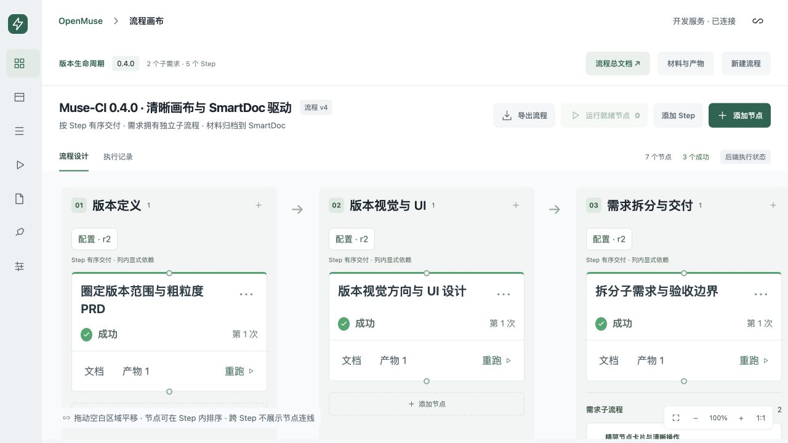
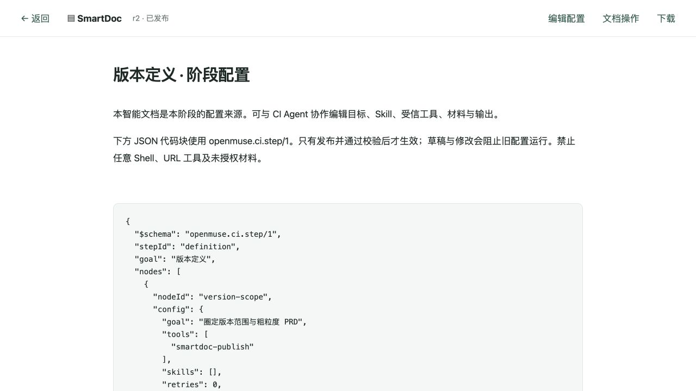
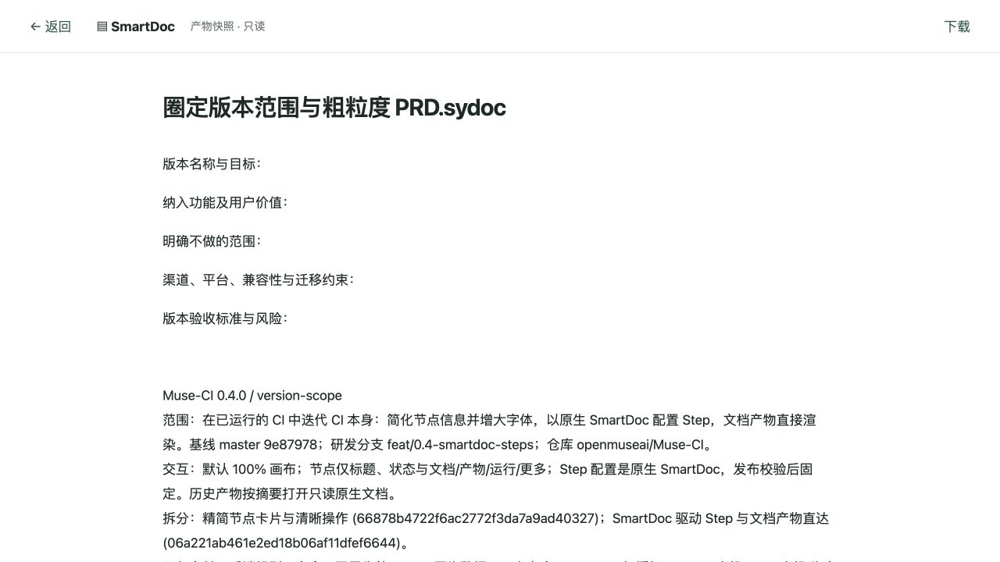

# Muse-CI 0.4.0 开发验收记录

本轮由 Muse-CI 自身管理版本与两个需求。原型基线已推送到 `master`（`9e87978`），开发位于 `feat/0.4-smartdoc-steps`。本记录是开发验收，尚非正式发行通过。

## 已实现

- 节点默认仅显示名称、状态、尝试次数与文档/产物/运行/更多操作；默认缩放 100%，桌面标题 20px、移动端 19px。描述、能力、材料、日志及人工“标过”保留在详情。
- Step 配置入口直接打开原生 SmartDoc。`openmuse.ci.step/1` 原生代码块承载目标、节点、Skill、受信工具、材料与输出；发布时校验并应用，运行固定文档修订与 SHA-256。草稿、失效材料或配置漂移阻止执行。
- 文档材料直接打开 SmartDoc。历史 `.sydoc` 产物按原始字节与摘要打开只读快照，不指向可变的当前云文档。Web 提供正文阅读视图及配置编辑；Desktop/Mobile 通过通用资源路由进入完整原生 SmartDoc。
- 修正实际点击发现的表单副作用：打开产物不会再提交节点配置；Web 复验前后流程版本均为 v5。
- 活跃插件源码、打包脚本和 UI 测试归入本仓库 `plugin/`；Ecosystem 中原有 0.3 源码作为历史基线保留。

## 实际 CI 执行

入口：[0.4.0 版本流程](http://127.0.0.1:4180/?project=28f3b64ebea1be399461053ce13b32a8)。两个需求由主流程进入各自画布。

[执行回执](evidence/ci-runs.json)记录最终源码摘要、三个成功 Run、各节点真实 Attempt、产物摘要及阶段配置固定修订。两个需求均完成 PRD、UI、方案、实现核查、用例和实际测试/构建；版本完成定义、视觉与需求拆分。实现由本轮编码 Agent 完成；CI 的实现核查节点运行 `ci-inspect`，不冒充后端模型生成代码。

[原生归档索引](archive/INDEX.json)共 3 个流程、39 份 `.sydoc`，按流程与 Step 分类，保留父子文档 ID、原生修订、发布修订与摘要。在线文档仍以流程内 ID 为权威；导出文件是保留修订快照。

## 验证结果

| 范围 | 结果 | 证据与边界 |
| --- | --- | --- |
| 后端 | 61 项通过，TypeScript 检查通过 | 配置编译、发布/漂移门禁、固定输入、历史产物及权限 |
| 插件 | 23 项通过，MCPB 构建通过 | 图模型、状态、SmartDoc 安全渲染；最终 UI 修复后重跑 |
| 持久执行端到端 | 28 项通过 | 实际 MCP、PostgreSQL、Temporal；配置固定与原始产物读取 |
| Host 通用资源层 | 9 项通过，1 项可选实际后端测试跳过 | 原生资源摘要、账号边界、只读；另有实际 MCPB 与手机验证 |
| Desktop Host MCPB | 实际加载测试通过 | [Host 日志](../../../plugin/docs/evidence/live-e2e/desktop-host-conformance.log)；最终包重跑通过 |
| Android PKM110 | 12 项里程碑通过 | [原生回执](evidence/mobile-artifact-111861.json)、[测试套件](evidence/mobile-artifact-111861-suite.json)：普通安装入口、CN 账号、0.4 UI、真实 MCP 原生数据读取、完整 SmartDoc 正文、只读且不连接可变云文档 |
| Web 实际交互 | 通过 | 100% 画布、创建/发布配置、已发布头部、原生正文快照、查看不保存；见截图 |
| Desktop 实际点击 | 待完成 | QA 已构建并安装；本轮末 Mac 自动锁屏，系统禁止窗口自动化，已请求解锁。不可将 MCPB 加载测试等同于此项通过 |

手机测试构建为 `1.0.2+111861`，已恢复普通 QA `1.0.2+111862`；最后的表单按钮修复已更新到同一安装配置。未操作其他设备。Host 通用实现提交为 Muse-Client `b84c2bc0`，真机测试提交为 `096521f1`。正式安装的 OpenMuse.app 未替换。

## 后续门禁与限制

- MR 保持草稿，等待 Desktop 实际点击验收及评审；未合并、未上架。版本回归与渠道发布节点仍保留门禁。
- 本地后端和手机 USB 转发是本轮环境；没有据此宣称生产市场、OAuth 或 iOS 真机验证完成。
- Web 阅读器支持正文、标题、富文本、列表、引用、代码与表格；完整原生编辑与复杂块使用 Host SmartDoc。图片不会由 Web 自动向外部地址发送请求。
- 构建使用相邻 Ecosystem 工程生成的 SmartDoc WASM 资产；当前仓库尚不是脱离工程组的独立离线构建包。相关上游许可证不移除。
- 推送前扫描公开源码、证据与原生文档状态，确保不包含已授权账号密码、MCP Token 或 GitHub Token。

